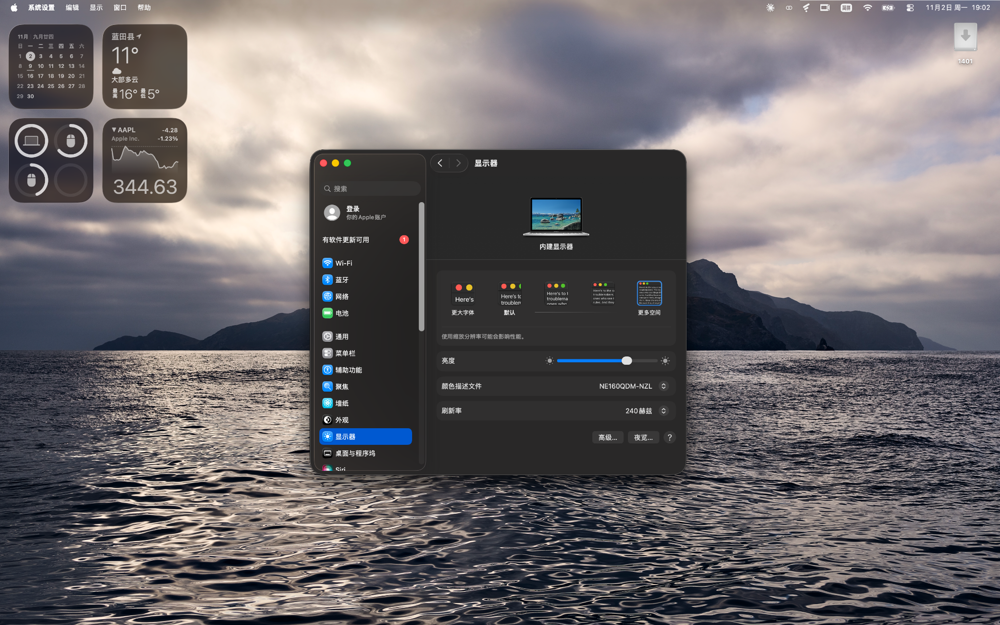
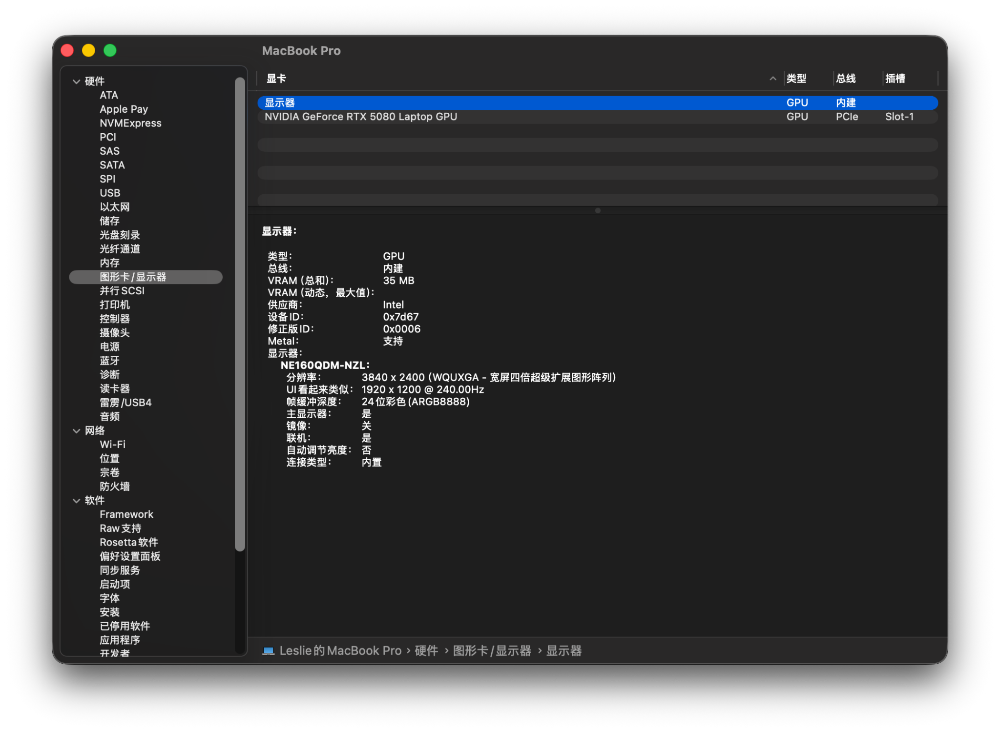

# ArrowWhatever

**ArrowWhatever** 是面向 macOS Tahoe 的 Intel Arrow Lake-HX 核显图形驱动项目，主要针对 Intel Core Ultra 9 275HX 的 Xe-LPG 核显。

项目基于 [XeGfx](https://github.com/watchthelight-labs/XeGfx) 和 [NvGfx](https://github.com/watchthelight-labs/NvGfx/tree/xe)，结合 [Mesa ANV](https://gitlab.freedesktop.org/mesa/mesa) 与 [XeMTL](https://github.com/watchthelight-labs/NvGfx/tree/497d521e925bd760c8cde5bbc17d9bf96d2ee2b4/plugin)，建立了从 Metal 图形渲染、GPU 命令提交到内建屏显示的完整路径。

在此基础上，ArrowWhatever 实现了 Intel 原生显示、高刷新率 HiDPI、GGTT 零拷贝翻转、压缩扫描及 GPU 渲染优化，并通过 i915 管理显示模式、硬件光标和内建屏背光。

## 当前实现

项目已经打通 macOS 图形系统与 Intel 核显之间的主要链路。

| 功能       | 实现情况                                                   |
| -------- | ------------------------------------------------------ |
| GPU 加速   | XeGfx、Mesa ANV 与 XeMTL 协同运行，支持 WindowServer 的 Metal 合成 |
| 原生显示     | i915 接管内建 eDP，支持 EDID、DPCD 读取及显示模式设置                   |
| 高刷新率     | 1920×1200 HiDPI @ 240 Hz，3840×2400 后备光栅与双管拼接           |
| 启动显示     | 自动恢复已选择的显示模式，启动后进入加速桌面                                 |
| 硬件光标与背光  | 独立光标平面及 i915 背光控制                                      |
| 显示翻转     | GGTT 零拷贝、延迟翻转与逐帧 GPU 完成同步                              |
| 压缩渲染与扫描  | Tile4、CCS 压缩及压缩图像直接扫描                                  |
| 图形内存管理   | IOSurface Device Cache、page-off、按 surface 导入及内存池       |
| 显示能力协商   | AGDC 颜色处理级别、BGRA 平面格式及 HiDPI 平面尺寸                      |
| GPU 执行优化 | Mesa ANV 常量推送、资源驻留管理及 libdrm 适配                        |

目前的开发工作集中在提高 WindowServer 合成吞吐、完善显示色彩管理、GPU 动态调频及图形内存同步，部分系统动画仍有优化空间，夜览暂时无法正常色调调节。

## 工作原理

ArrowWhatever 沿用 XeGfx 的 Intel GPU 驱动基础，通过 XeMTL 将 macOS 的 Metal 图形操作转换为 Vulkan，再由 Mesa ANV 提交给 i915 执行。

显示部分由 XeGfx core、XeGfxDisplay 和 XeGfxAccel 协作完成。驱动从固件获取内建屏信息，经 AUX 读取面板参数，由 i915 建立显示管线并完成模式设置。

WindowServer 生成的图像通过 GGTT 映射进入显示地址空间，在 GPU 完成渲染后交由显示引擎扫描。显示平面同时支持线性、Tile4 与 CCS 压缩布局，使 GPU 的渲染结果能够直接进入扫描输出。

## 主要技术进展

### 原生显示与 240 Hz HiDPI

原生显示接管从读取固件留下的显示状态开始，逐步发展到由 i915 自行设置 eDP 链路、显示模式和扫描平面。

在高分辨率、高刷新率下，驱动使用两条显示管线协同扫描 3840×2400 光栅，并通过 DSC 完成面板输出。显示模式可以保存并在下次启动时恢复，硬件光标与背光控制也已接入原生显示路径。

相关设计见 [原生显示接管与开机模式](docs/kms-boot-mode.md)。

### 零拷贝与延迟翻转

早期显示路径需要由 CPU 将整帧图像复制到显示缓冲区。ArrowWhatever 通过 GGTT 将 WindowServer 合成的 IOSurface 映射到显示地址空间，使显示引擎能够直接读取图像。

K9 延迟翻转进一步将 GPU 完成等待与显示翻转交给内核工作线程，并通过逐帧完成标记维护渲染与扫描之间的执行顺序，减少显示事务对 WindowServer 的阻塞。

相关设计见 [零拷贝翻转](docs/zero-copy-flip.md)、[K9 延迟翻转](docs/k9-deferred-flip.md)和[帧流水线](docs/frame-pipeline.md)。

### Tile4、page-off 与压缩扫描

WindowServer 的桌面合成需要频繁读写大尺寸图像。项目使用 Tile4 布局与 CCS 渲染压缩降低图像访问开销，并通过 IOSurface Device Cache 和 page-off 协调 GPU 私有图像与 CPU 可访问页面之间的数据同步。

在此基础上，压缩扫描使显示引擎能够直接读取 Tile4 + MTL RC CCS 图像。驱动通过 GGTT 管理压缩图像的物理页，并同步维护主平面与 CCS 元数据，减少扫描前的图像复制。

详细机制见 [page-off 与渲染压缩](docs/page-off-and-compression.md)及[压缩扫描与图形内存优化](docs/render-compression.md)。

### 显示能力与图形内存优化

ArrowWhatever 通过 AGDC 向 CoreDisplay 提供显示平面的颜色处理级别、BGRA 格式和桌面尺寸约束，使系统能够依据显示控制器的能力组织显示事务。这一机制也为减少额外的全屏 GPUPass 和进一步实现硬件色彩管理提供了基础。

图形内存方面，项目增加了基于 IOSurface 自身物理内存的导入路径，减少 userptr 逐页映射开销，并修复了大尺寸 GEM 映射与 libdrm 导出句柄复用问题。

Mesa ANV 进一步支持 XeMTL 资源驻留声明、只读 SSBO 与地址表常量推送，减少 GPU 提交和着色器执行中的冗余工作。

具体实现见 [压缩扫描、图形内存与 ANV 优化](docs/render-compression.md)。

## 测试与性能

项目公开了驱动构建标识、原始测试日志、逐帧时间线与分析工具，用于验证图形渲染、扫描输出和性能优化。

- [原始测试日志与说明](logs/README.md)
- [数据采集及分析工具](scripts/tools/)
- [帧流水线与性能分析](docs/frame-pipeline.md)
- [压缩扫描与性能分析](docs/render-compression.md)

## 构建与使用

项目以补丁形式维护对上游驱动的修改，使用以下固定源码基点：

| 组件               | 上游基点                                                                                                                   |
| ---------------- | ---------------------------------------------------------------------------------------------------------------------- |
| XeGfx core 与显示组件 | NvGfx `xe` · [`5a19a73f`](https://github.com/watchthelight-labs/NvGfx/commit/5a19a73f36249efb99c44c3f9cb34603ef0c0eb8) |
| XeMTL 插件         | NvGfx `xe` · [`497d521e`](https://github.com/watchthelight-labs/NvGfx/commit/497d521e925bd760c8cde5bbc17d9bf96d2ee2b4) |
| Mesa ANV         | Mesa `bffd9194`，叠加 NvGfx 移植补丁                                                                                          |
| libdrm           | libdrm `b97cbde1`，叠加 NvGfx 移植补丁                                                                                        |

获取对应源码后，按照 [补丁应用说明](patches/README.md) 中的顺序应用补丁，即可建立驱动源码树。当前补丁系列覆盖 XeGfx、XeMTL、Mesa ANV、libdrm 及开发工具。

项目提供构建、安装、AuxKC 更新、启动验证及回滚工具。外部源码与构建产物通过 `XEGFX_*` 环境变量指定。

完整流程参见 [构建与安装说明](docs/building.md)。

## 技术文档

| 主题                        | 文档                                               |
| ------------------------- | ------------------------------------------------ |
| 原生显示、双管拼接与硬件光标            | [KMS 显示接管](docs/kms-boot-mode.md)                |
| GGTT 零拷贝                  | [零拷贝翻转](docs/zero-copy-flip.md)                  |
| 延迟翻转                      | [K9 设计记录](docs/k9-deferred-flip.md)              |
| 逐帧 GPU 同步与帧率分析            | [帧流水线](docs/frame-pipeline.md)                   |
| Tile4、Device Cache 与 CCS  | [page-off 与压缩](docs/page-off-and-compression.md) |
| 压缩扫描、IOSurface 导入及 ANV 优化 | [渲染与显示优化](docs/render-compression.md)            |
| userptr 生命周期修复            | [内核崩溃分析](docs/userptr-panic.md)                  |
| 图形内存导入修复                  | [device lost](docs/device-lost.md)               |
| 代码与构建                     | [补丁说明](patches/README.md)                        |
| 测试数据                      | [原始日志](logs/README.md)                           |

## 许可与致谢

ArrowWhatever 基于 [NullMoth Systems](https://nullmothsystems.com) 的 macOS 图形驱动体系，以及 [watchthelight-labs/XeGfx](https://github.com/watchthelight-labs/XeGfx) 和 [NvGfx](https://github.com/watchthelight-labs/NvGfx/tree/xe) 的研究成果。项目同时使用 Mesa ANV、[metal2vulkan](https://github.com/steelbrain/metal2vulkan)、[FreeBSD drm-kmod](https://github.com/freebsd/drm-kmod) 和 Intel i915 等组件。

`patches/` 沿用上游的 **PolyForm Noncommercial License 1.0.0**，用于非商业研究与开发。项目原创的文档和脚本采用 **MIT License**。完整许可条款和第三方来源分别见 [LICENSE](LICENSE)、[LICENSE-MIT](LICENSE-MIT) 与 [NOTICE.md](NOTICE.md)。

感谢上游开发者及相关社区的工作。项目由 LLM 辅助开发，仍处于实验性研究阶段。
